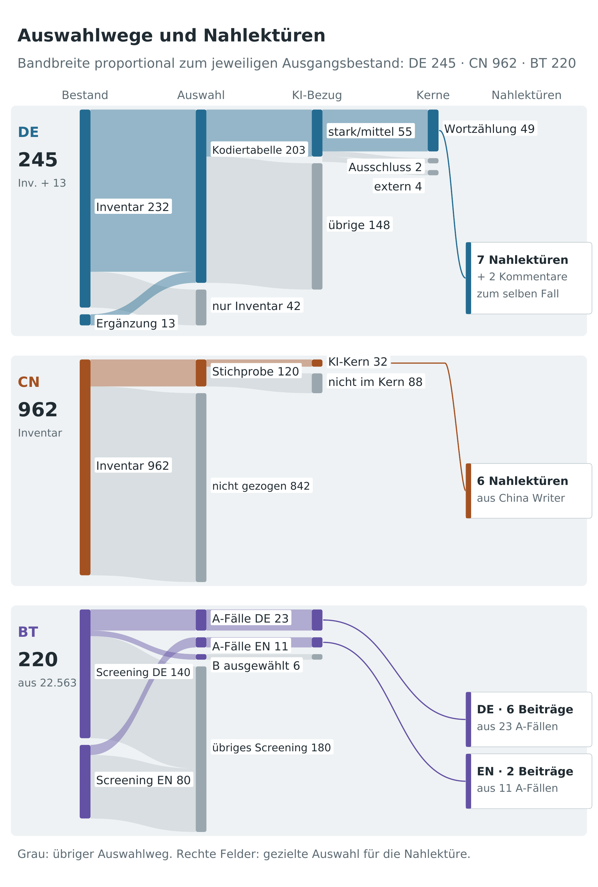
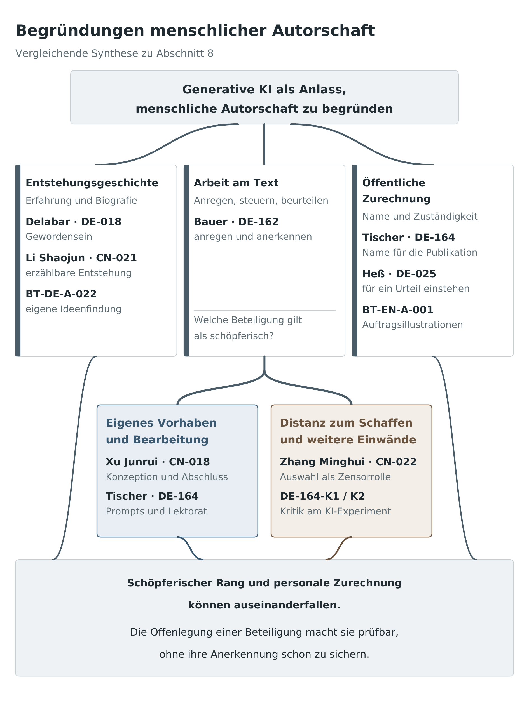

# Authorship under Pressure

Research data, source references and figures accompanying Christoph auf der Horst’s German-language article **“Autorschaft unter Begründungsdruck. Generative KI in chinesischen Literaturdebatten, deutschen Literaturportalen und auf BookTok”** (*Authorship under Pressure: Generative AI in Chinese Literary Debates, German Literary Portals and on BookTok*).

**Repository version 1.0 · 19 November 2026 · Corresponding manuscript: v12**

The study compares how human authorship is justified and contested in German literary portals, Chinese literary discourse, and German- and English-language BookTok posts. It combines corpus-assisted exploration, drawing on Clyde Ancarno’s account of *Corpus-Assisted Discourse Studies* (CADS), with contextual close reading. Wolfgang Iser’s literary anthropology informs the question of how literary creation and reading are understood to contribute to human self-experience.

The argument draws on **21 main contributions**: seven German portal articles, six Chinese contributions and eight BookTok posts. Two comments on the same German production report and one Chinese journalistic report provide additional evidence. This repository documents the cases, their selection and the available analytical procedures. The unpublished manuscript is not included.

## Materials and methods

- [Materials and selection](docs/Material_und_Auswahl.md): collection inventories, selection stages and their relationship to the 21 main contributions.
- [CADS and close reading](docs/CADS_und_Nahlektuere.md): methodological approach and scope of the word-form analysis.
- [Case index](data/belegstellen_v12.csv) and [reading guide](docs/Belegstellen_v12.md): source locations, speaker roles, evidential functions and limits of each case.
- [Data collection and verification](docs/Erhebung_und_Pruefung.md): preliminary coding, translations and source checks.
- [AI use statement](AI_USAGE.md): tools, language assistance, programming and author responsibility.
- [Data and limitations](docs/Daten_und_Grenzen.md): file descriptions and scope of public reproducibility.

The documentation is in English. Source titles, case descriptions, historical coding labels and the manuscript figures retain their original language. The [data guide](data/README.md) explains the German fields in the case index; both figures have English descriptions below.

## Figures

Both figures correspond to those used in manuscript v12. Each folder contains print-ready files, a vector graphic, a German reading text, source data and a generation script. [Interpretation guide](docs/Abbildungen.md).

### Figure 1 · Selection pathways and close readings



[PDF](figures/figure_1/Abb_Korpus_Sankey_K3.pdf) · [SVG](figures/figure_1/Abb_Korpus_Sankey_K3.svg) · [English description](figures/figure_1/Description.en.md) · [Files and reproduction](figures/figure_1/README.md)

### Figure 2 · Justifications of human authorship



[PDF](figures/figure_2/Abb_Autorschaft_K8.pdf) · [SVG](figures/figure_2/Abb_Autorschaft_K8.svg) · [English description](figures/figure_2/Description.en.md) · [Files and reproduction](figures/figure_2/README.md)

## Reproducing the calculations

The word-form data cover 49 German article bodies: 12,925 tokens from literaturkritik.de and 30,923 from literaturcafe.de. The retained thematic family assignments cover 32 Chinese core texts, 23 German BookTok A-cases and eleven English A-cases. These earlier exploratory collections differ from the purposive selection of 21 main contributions. Their categories are not retrospectively presented as uniform codes for the current argument.

```sh
python3 -m pip install -r requirements.txt
python3 scripts/reproduce.py
python3 -m unittest discover -s tests -v
```

The scripts recalculate aggregates from the published counts and assignments. Extracting and tokenising the original texts requires the unpublished source archive. Generating the figures additionally requires Poppler with `pdftoppm`:

```sh
python3 figures/figure_1/build_sankey.py
python3 figures/figure_2/build_figure.py
```

Outputs are stored in [results/](results/). [The validation report](VALIDIERUNG.md) documents the checks performed. Computational checks do not establish independent coding or linguistic verification of the sources.

## AI assistance

ChatGPT/Codex (OpenAI), a language model accessed via the Anthropic API, and translation software were used to assist in the preparation of this article. This included AI-assisted data processing, the development of analysis and figure generation scripts, and the revision of draft texts. The [AI use statement](AI_USAGE.md) describes these tasks, the documented tools and the limits of historical version records. Source checks are described in [Data collection and verification](docs/Erhebung_und_Pruefung.md).

## Citation and reuse

[Release 1.0](https://github.com/ch-auf-der-horst/literary-anthropologies-cads/releases/tag/v1.0) provides the repository version accompanying manuscript v12. Citation metadata are available in [CITATION.cff](CITATION.cff); a suggested reference appears in the [citation guide](docs/Fussnoten.md).

Original data, documentation and figures are licensed under **CC BY 4.0**; scripts and tests are licensed under **MIT**. See [LICENSE](LICENSE) and [RIGHTS.md](RIGHTS.md). Rights in external sources remain with their respective rights holders. Article full texts, complete platform texts, videos and private identification keys are not published. BookTok evidence is identified by internal case IDs.
